# DRF Parsers, Serializers, Pagination

## 1 Parsers

Parse the data (JSON) sent by the requester.

Use `request.data` to get the data in the request body.

How does this `request.data` come about? Actually, inside DRF it is handled by parsers based on the data format sent by the requester plus the request headers.

DRF's default parsers are three: `JSONParser`, `FormParser`, and `MultiPartParser`.

### 1.1 JSONParser (*)

Only supports JSON-format data.

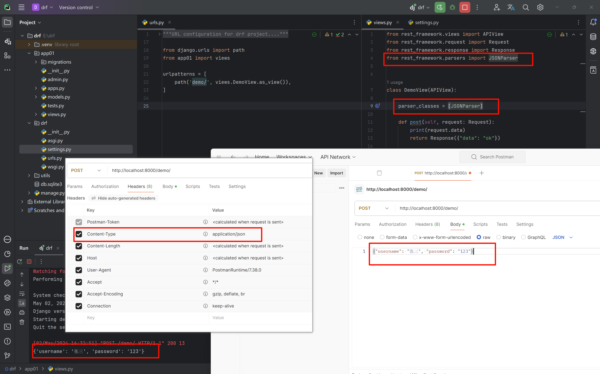


### 1.2 FormParser

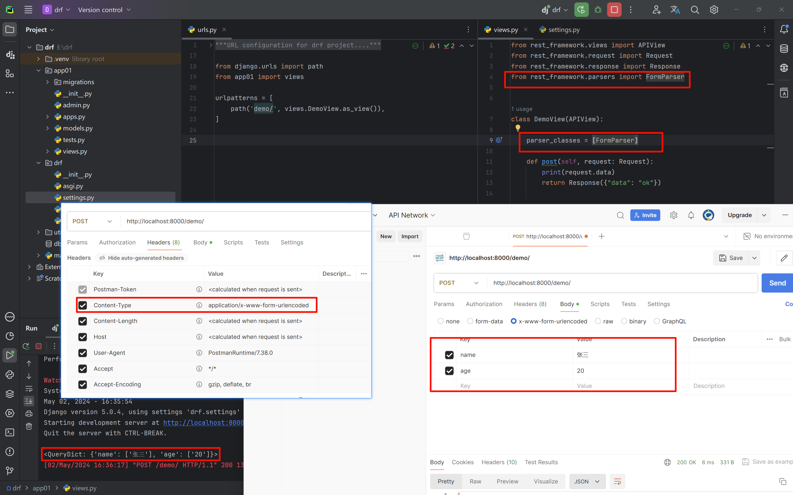


### 1.3 MultiPartParser (*)

Supports both sending data and transferring files.

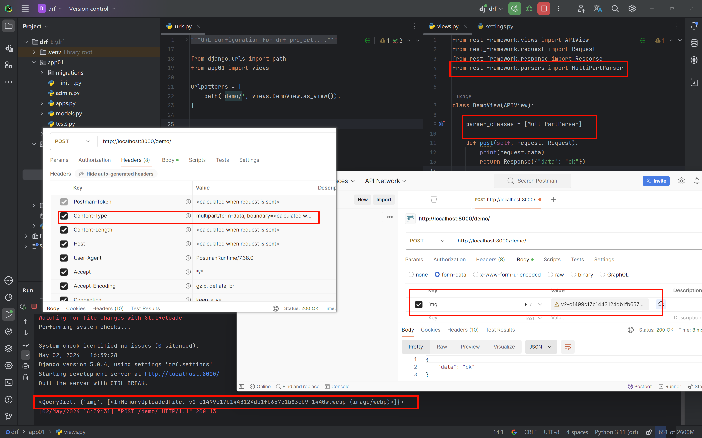


### 1.4 FileUploadParser

Only supports file transfer.

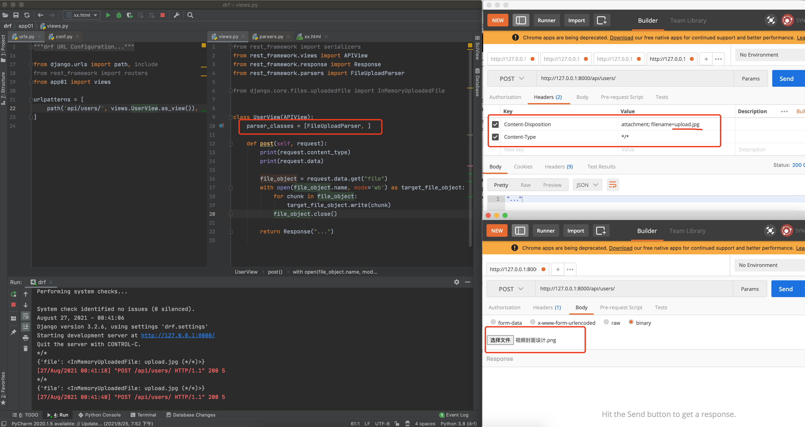

Multiple parsers can be configured. The default parsers are:

```python
from rest_framework.views import APIView
from rest_framework.response import Response
from rest_framework.parsers import MultiPartParser, JSONParser, FormParser

class UserView(APIView):
    parser_classes = [MultiPartParser, JSONParser, FormParser]
    def post(self, request):
        print(request.content_type)
        print(request.data)
        return Response("...")
```


### 1.5 Source Code Analysis

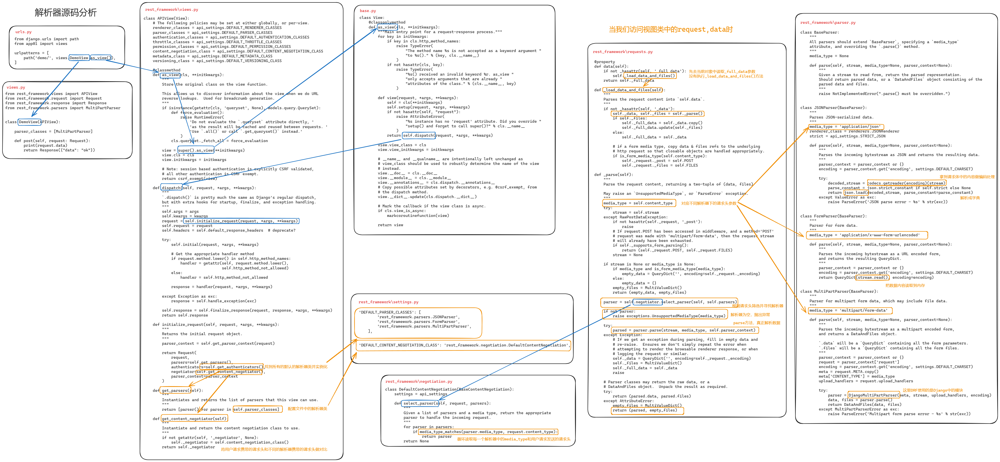


## 2 Serializers

- Validate the data submitted by the user.
- Retrieve data from the database, serialize it, and return it to the frontend in JSON format.

### 2.1 Serializing Data

#### 2.1.1 Serializer

```python
# models.py
from django.db import models

class Depart(models.Model):
    """Department table"""
    title = models.CharField(verbose_name="Title", max_length=32)
    number = models.CharField(verbose_name="Code", max_length=16, default=1)
```

```python
# views.py
from rest_framework.views import APIView
from rest_framework.response import Response
from rest_framework import serializers
from api import models


class DemoSerializer(serializers.Serializer):
    id = serializers.IntegerField()
    title = serializers.CharField()
    number = serializers.CharField()


class DemoView(APIView):
    def get(self, request):
        # 1. Retrieve multiple records from the database
        # queryset = models.Depart.objects.all()
        # ser = DemoSerializer(instance=queryset, many=True) internally loops over each object in queryset and returns

        # 2. Retrieve a single record from the database
        instance = models.Depart.objects.filter(id=1).first()
        ser = DemoSerializer(instance=instance, many=False)
        
        print(type(ser.data), ser.data)
        return Response(ser.data)
```


#### 2.1.2 ModelSerializer

```python
from django.db import models


class Depart(models.Model):
    """Department table"""
    title = models.CharField(verbose_name="Title", max_length=32)
    number = models.CharField(verbose_name="Code", max_length=16, default=1)
```

```python
from rest_framework.views import APIView
from rest_framework.response import Response
from rest_framework import serializers
from api import models


class DemoSerializer(serializers.ModelSerializer):
    class Meta:
        model = models.Depart
        # fields = "__all__"	# All fields
        # fields = ['id', 'title', 'number']	# Specify fields
        exclude = ["id"]	# Exclude a certain field


class DemoView(APIView):
    def get(self, request):
        # 1. Retrieve multiple records from the database
        # queryset = models.Depart.objects.all()
        # ser = InfoSerializer(instance=queryset, many=True)

        # 2. Retrieve a single record from the database
        instance = models.Depart.objects.filter(id=1).first()
        ser = InfoSerializer(instance=instance, many=False)

        print(type(ser.data), ser.data)
        return Response(ser.data)
```

Obviously, when serializing the fields of a database table, using `ModelModelSerializer` is more concise than using `Serializer`.


#### 2.1.3 Custom Fields and Parameters

Custom fields can be defined in both `ModelModelSerializer` and `Serializer`, and some related parameters can be passed in.

```python
from django.db import models


class Depart(models.Model):
    """Department table"""
    title = models.CharField(verbose_name="Title", max_length=32)
    number = models.CharField(verbose_name="Code", max_length=16, default=1)


class UserInfo(models.Model):
    name = models.CharField(verbose_name="Name", max_length=32)
    gender = models.SmallIntegerField(verbose_name="Gender", choices=((1, "Male"), (2, "Female")))
    role = models.ForeignKey(verbose_name="Role", to="Role", on_delete=models.CASCADE)
    ctime = models.DateTimeField(verbose_name="Creation time", auto_now_add=True)
```

```python
from rest_framework.views import APIView
from rest_framework.response import Response
from rest_framework import serializers
from api import models


class InfoSerializer(serializers.ModelSerializer):
    gender = serializers.CharField(source="get_gender_display")
    role = serializers.CharField(source="role.title")
    ctime = serializers.DateTimeField(format="%Y-%m-%d")
    other_name = serializers.CharField(source="name")
    mine = serializers.SerializerMethodField()

    class Meta:
        model = models.UserInfo
        fields = ['id', 'name', 'gender', "role", 'ctime', "other_name", "mine"]

    def get_mine(self, obj):
        return "x-x-{}".format(obj.name)


class InfoView(APIView):
    def get(self, request):
        queryset = models.UserInfo.objects.all()
        ser = InfoSerializer(instance=queryset, many=True)
        print(type(ser.data), ser.data)
        return Response(ser.data)
```


#### 2.1.4 Serializer Class Nesting

This is mainly for serializing the fields in ORM classes that correspond to `ForeignKey` and `ManyToManyField`.

- Serialize related-table data based on a custom method of `SerializerMethodField`.
- Implement via nested serializer classes.

```python
# models.py
from django.db import models


class Role(models.Model):
    title = models.CharField(verbose_name="Title", max_length=32)
    order = models.IntegerField(verbose_name="Order")


class Tag(models.Model):
    caption = models.CharField(verbose_name="Name", max_length=32)


class UserInfo(models.Model):
    name = models.CharField(verbose_name="Name", max_length=32)
    gender = models.SmallIntegerField(verbose_name="Gender", choices=((1, "Male"), (2, "Female")))
    role = models.ForeignKey(verbose_name="Role", to="Role", on_delete=models.CASCADE)
    ctime = models.DateTimeField(verbose_name="Creation time", auto_now_add=True)

    tags = models.ManyToManyField(verbose_name="Tag", to="Tag")
```

```python
# views.py
from rest_framework.views import APIView
from rest_framework.response import Response
from rest_framework import serializers
from api import models


class RoleSerializer(serializers.ModelSerializer):
    class Meta:
        model = models.Role
        # fields = "__all__"
        fields = ["id", 'title']


class TagSerializer(serializers.ModelSerializer):
    class Meta:
        model = models.Tag
        fields = "__all__"


class InfoSerializer(serializers.ModelSerializer):
    role = RoleSerializer()
    tags = TagSerializer(many=True)

    class Meta:
        model = models.UserInfo
        fields = ['id', 'name', "role", "tags"]


class InfoView(APIView):
    def get(self, request):
        queryset = models.UserInfo.objects.all()
        ser = InfoSerializer(instance=queryset, many=True)
        print(type(ser.data), ser.data)
        return Response(ser.data)
```


#### 2.1.5 Serializer Class Inheritance

```python
# views.py
from rest_framework.views import APIView
from rest_framework.response import Response
from rest_framework import serializers
from api import models


class MySerializer(serializers.Serializer):
    more = serializers.SerializerMethodField()

    def get_more(self, obj):
        return "123"


class InfoSerializer(serializers.ModelSerializer, MySerializer):
    class Meta:
        model = models.UserInfo
        fields = ["id", "name", 'more']


class InfoView(APIView):
    def get(self, request):
        instance = models.UserInfo.objects.all().first()
        ser = InfoSerializer(instance=instance, many=False)

        print(type(ser.data), ser.data)
        return Response(ser.data)
```


#### 2.1.6 Underlying Implementation Principles

##### 1. Metaclasses

Objects are instantiated from classes.

```python
class Foo(object):
    pass

# Step 1: Call Foo's __new__ method to create an empty object.
# Step 2: Call Foo's __init__ method to initialize the object.
obj = Foo()
```

Who creates classes? They are created by `type` (by default).

```python
class Foo(object):
    v1 = 123
    
    def func(self):
        return 666
```

```python
Foo = type("Foo",(object,),{ "v1":123, "func":lambda self:666 })
```

```
Execution logic is:
	First create the parameters, such as v1=123 and the func method above, then create the class
```

```python
# Format for creating a class with type
# ClassName = type("ClassName", (ParentClass), {members})
```

When defining a class, you can add `metaclass` to specify the creator of the current class.

```python
# Create Foo type by type
class Foo(object):
    pass
```

```python
# Create Foo type by `thing`
class Foo(object,metaclass=thing):
    pass
```

Specify a metaclass to create the class.

```python
class MyType(type):
    def __new__(cls, *args, **kwargs):
        new_cls = super().__new__(cls, *args, **kwargs)
        print("Creating class:", new_cls)
        return new_cls

class Foo(metaclass=MyType):
    pass
```

```python
class MyType(type):
    def __init__(self, *args, **kwargs):
        print("Step 2: Initialize class members:", args, **kwargs)
        super().__init__(*args, **kwargs)

    def __new__(cls, *args, **kwargs):
        new_cls = super().__new__(cls, *args, **kwargs)
        print("Step 1: Create class:", new_cls)
        return new_cls


class Foo(metaclass=MyType):
    v1 = 123

    def func(self):
        pass
```

```python
class MyType(type):
    def __init__(cls, *args, **kwargs):
        print("Step 2: Initialize class members:", args, **kwargs)
        super().__init__(*args, **kwargs)

    def __new__(cls, *args, **kwargs):
        new_cls = super().__new__(cls, *args, **kwargs)
        print("Step 1: Create class:", new_cls)
        return new_cls

    def __call__(cls, *args, **kwargs):
        print("Step 3: Create and initialize object", cls)

        # 1. Call the __new__ method of your own class to create the object
        new_object = cls.__new__(cls, *args, **kwargs)

        # 2. Call the __init__ method of your own class to initialize
        cls.__init__(new_object, *args, **kwargs)
        return new_object


class Foo(metaclass=MyType):
    v1 = 123

    def func(self):
        pass


obj = Foo()
```

##### 2. Instantiating Field Objects

```python
from rest_framework.views import APIView
from rest_framework.response import Response
from rest_framework import serializers
from api import models


class InfoSerializer(serializers.Serializer):
    id = serializers.IntegerField()
    title = serializers.CharField()
    order = serializers.IntegerField
```

**For the above code, before the `InfoSerializer` class is created, its internal `id`, `title`, and `order` fields are instantiated as objects first.**

The inheritance relationships of these `IntegerField`, `CharField`, and other fields are as follows:

```python
class Field:
    _creation_counter = 0
    
class IntegerField(Field):
    pass

class CharField(Field):
    pass

class DateTimeField(Field):
    pass
```


When `IntegerField`, `CharField`, and other fields are instantiated, a counter is maintained internally to indicate the order of instantiation.

```python
class Field:
    _creation_counter = 0
	def __init__(self, *, read_only=False...):
        self._creation_counter = Field._creation_counter
        Field._creation_counter += 1

class IntegerField(Field):
	def __init__(self, **kwargs):
        ...
        super().__init__(**kwargs)

class CharField(Field):
	def __init__(self, **kwargs):
        ...
        super().__init__(**kwargs)
```

```python
from rest_framework.views import APIView
from rest_framework.response import Response
from rest_framework import serializers
from api import models


class InfoSerializer(serializers.Serializer):
    id = serializers.IntegerField()  # object, internal _creation_counter=0
    title = serializers.CharField()  # object, internal _creation_counter=1
    order = serializers.IntegerField # object, internal _creation_counter=2
```

Note: this counter is later used for sorting, in order to control the execution order of fields.


##### 3. Creation of the Serializer Class

```python
class SerializerMetaclass(type):
	def __new__(cls, name, bases, attrs):
        attrs['_declared_fields'] = cls._get_declared_fields(bases, attrs)
        return super().__new__(cls, name, bases, attrs)
```

```python
class Serializer(BaseSerializer, metaclass=SerializerMetaclass):
	...

class ModelSerializer(Serializer):
	...
    
class RoleSerializer(serializers.ModelSerializer):
    gender = serializers.CharField(source="get_gender_display")
    class Meta:
        model = models.Role
        fields = ["id", 'title',"gender"]
```

Note: if a metaclass is specified in the parent class, the child class will also be created by this metaclass.


##### 4. _declared_fields

Before the class is created, the metaclass's `__new__` method adds a `_declared_fields` (class variable) to the class members.

```python
class SerializerMetaclass(type):
    @classmethod
    def _get_declared_fields(cls, bases, attrs):
        # 1. Loop through all members defined in the class (class variables, methods) and filter out field objects that inherit from Field.
        # Note: This also removes the field from the current class members
        fields = [
            (field_name, attrs.pop(field_name)) 
            for field_name, obj in list(attrs.items())
            if isinstance(obj, Field)
        ]
        # 2. Sort by the field's _creation_counter
        fields.sort(key=lambda x: x[1]._creation_counter)

        # Ensures a base class field doesn't override cls attrs, and maintains
        # field precedence when inheriting multiple parents. e.g. if there is a
        # class C(A, B), and A and B both define 'field', use 'field' from A.
        known = set(attrs)

        def visit(name):
            known.add(name)
            return name
		
        # 3. Read _declared_fields from parent classes (parent classes are created before child classes, serializer classes support inheritance)
        base_fields = [
            (visit(name), f)
            for base in bases if hasattr(base, '_declared_fields')
            for name, f in base._declared_fields.items() if name not in known
        ]
		
        # 4. Pack and return fields from parent and child classes, assign to the current class's _declared_fields
        return OrderedDict(base_fields + fields)

    def __new__(cls, name, bases, attrs):
        attrs['_declared_fields'] = cls._get_declared_fields(bases, attrs)
        return super().__new__(cls, name, bases, attrs)
```

```python
class Serializer(BaseSerializer, metaclass=SerializerMetaclass):
	...

class ModelSerializer(Serializer):
	...
    
class RoleSerializer(serializers.ModelSerializer):
    gender = serializers.CharField(source="get_gender_display")
    class Meta:
        model = models.Role
        fields = ["id", 'title',"gender"]
```

Therefore, after the serializer class has finished loading, the class members are:

- Removed: the field objects.

  ```python
  RoleSerializer.gender   does not exist
  ```

- Added: `_declared_fields`, which is of type `OrderedDict` and contains all fields.

  ```python
  RoleSerializer._declared_fields = {
      "gender": CharField object
  }
  ```

- Others: kept as they are.

  ```python
  RoleSerializer.Meta
  ```


##### 5. Creating Serializer Class Objects

In view methods, when using a serializer class to serialize a QuerySet or object obtained via ORM, you first need to instantiate the class.

```python
class SerializerMetaclass(type):
	def __new__(cls, name, bases, attrs):
        attrs['_declared_fields'] = cls._get_declared_fields(bases, attrs)
        return super().__new__(cls, name, bases, attrs)
```

```python
class BaseSerializer(Field):
    def __init__(self, instance=None, data=empty, **kwargs):
        self.instance = instance
        if data is not empty:
            self.initial_data = data
        self.partial = kwargs.pop('partial', False)
        self._context = kwargs.pop('context', {})
        kwargs.pop('many', None)
        super().__init__(**kwargs)

    def __new__(cls, *args, **kwargs):
        if kwargs.pop('many', False):
            # Call many_init method to get other objects and return
            return cls.many_init(*args, **kwargs)

        # Create an empty object of the current class and return
        return super().__new__(cls, *args, **kwargs)


    @classmethod
    def many_init(cls, *args, **kwargs):
		...
        child_serializer = cls(*args, **kwargs)
        list_kwargs = {
            'child': child_serializer,
        }
        meta = getattr(cls, 'Meta', None)
        list_serializer_class = getattr(meta, 'list_serializer_class', ListSerializer)
        return list_serializer_class(*args, **list_kwargs)
    
class Serializer(BaseSerializer, metaclass=SerializerMetaclass):
	...

class ModelSerializer(Serializer):
	...
    
class RoleSerializer(serializers.ModelSerializer):
    gender = serializers.CharField(source="get_gender_display")
    class Meta:
        model = models.Role
        fields = ["id", 'title',"gender"]
```

```python
instance = models.UserInfo.objects.all().first()

# Instantiate object; internally: first execute __new__, then __init__
# Step 1: __new__
# 	By default: many=True returns a ListSerializer object; many=False returns an object of the current class InfoSerializer.
# Step 2: __init__
#   Here, execute the __init__ method of the different object returned by __new__.
# =====> Think about it: Why do you think it was designed this way? <======
ser = InfoSerializer(instance=instance, many=False)

# Get the serialized value
ser.data
```


##### 6. Serialization - The Current Class

```python
class Field:
    def get_attribute(self, instance):
        # source_attrs=[]  or source_attrs=["xx","xx","xxx"]
		return get_attribute(instance, self.source_attrs)
    
class CharField(Field):
    def to_representation(self, value):
        return str(value)
```

```python
class BaseSerializer(Field):
    @property
    def data(self):
        # Step 2
        if not hasattr(self, '_data'):
            if self.instance is not None and not getattr(self, '_errors', None):
                # Step 3: Used for serializing and initializing the object.
                self._data = self.to_representation(self.instance)
            elif hasattr(self, '_validated_data') and not getattr(self, '_errors', None):
                # This is triggered only when validating the request.
                self._data = self.to_representation(self.validated_data)
            else:
                # This is used for Serializer when no object is passed but initial_data is passed.
                self._data = self.get_initial()
        return self._data

class Serializer(BaseSerializer, metaclass=SerializerMetaclass):
    @property
    def data(self):
        # Step 1
        ret = super().data
        return ReturnDict(ret, serializer=self)
	
    def to_representation(self, instance):
        # Step 4
        ret = OrderedDict()
        
        # Step 5: Get all non-write_only fields from _declared_fields, i.e., fields used for serialization.
        #       If it is a ModelSerializer, it will also look for fields defined in its Meta + the field's bind method
        fields = self._readable_fields

        for field in fields:
            try:
                # Step 5: Call the get_attribute method of the field object
                attribute = field.get_attribute(instance)
            except SkipField:
                continue

            check_for_none = attribute.pk if isinstance(attribute, PKOnlyObject) else attribute
            if check_for_none is None:
                ret[field.field_name] = None
            else:
                # Step 6: Call the to_representation method of the field object
                ret[field.field_name] = field.to_representation(attribute)

        return ret
    
class ModelSerializer(Serializer):
	...
    
class RoleSerializer(serializers.ModelSerializer):
    gender = serializers.CharField(source="get_gender_display")
    class Meta:
        model = models.Role
        fields = ["id", 'title',"gender"]
```

```python
instance = models.UserInfo.objects.all().first()
ser = InfoSerializer(instance=instance, many=False)

# Create an object of the InfoSerializer class and get the serialized value
ser.data
```


##### 7. Serialization - ListSerializer

```python
class BaseSerializer(Field):
    @property
    def data(self):
        if not hasattr(self, '_data'):
            if self.instance is not None and not getattr(self, '_errors', None):
                # Here
                self._data = self.to_representation(self.instance)
            elif hasattr(self, '_validated_data') and not getattr(self, '_errors', None):
                self._data = self.to_representation(self.validated_data)
            else:
                self._data = self.get_initial()
        return self._data

class ListSerializer(BaseSerializer):
	@property
    def data(self):
        ret = super().data
        return ReturnList(ret, serializer=self)
    
    def to_representation(self, data):
        iterable = data.all() if isinstance(data, models.Manager) else data
        
        return [
            # Loop, use the serializer class to process each object
            self.child.to_representation(item) for item in iterable
        ]
```


### 2.2 Data Validation

Validate and save the request data sent by the user.

```
GET request	-> Retrieve data (list)
POST request  -> Create data
PUT request   -> Update data
```


#### 2.2.1 Built-in Validation

```python
from rest_framework.views import APIView
from rest_framework.response import Response
from rest_framework import serializers


class InfoSerializer(serializers.Serializer):
    title = serializers.CharField(required=True, max_length=20, min_length=6)
    order = serializers.IntegerField(required=False, max_value=100, min_value=10)
    level = serializers.ChoiceField(choices=[("1", "Senior"), (2, "Intermediate")])


class InfoView(APIView):
    def post(self, request):
        ser = InfoSerializer(data=request.data)
        if ser.is_valid():
            return Response(ser.validated_data)
        else:
            return Response(ser.errors)
        
    # def post(self, request):
    #     ser = InfoSerializer(data=request.data)
    #     ser.is_valid(raise_exception=True)	If validation fails, return an error; if successful, continue (same in essence as above)
    #     return Response(ser.validated_data)
```


#### 2.2.2 Regex Validation

```python
from rest_framework.views import APIView
from rest_framework.response import Response
from rest_framework import serializers
from django.core.validators import RegexValidator, EmailValidator


class InfoSerializer(serializers.Serializer):
    title = serializers.CharField(required=True, max_length=20, min_length=6)
    order = serializers.IntegerField(required=False, max_value=100, min_value=10)
    level = serializers.ChoiceField(choices=[("1", "Senior"), (2, "Intermediate")])

    # email = serializers.EmailField()
    email = serializers.CharField(validators=[EmailValidator(message="Invalid email format")])

    more = serializers.CharField(validators=[RegexValidator(r"\d+", message="Format error")])

    code = serializers.CharField()


class InfoView(APIView):
    def post(self, request):
        ser = InfoSerializer(data=request.data)
        if ser.is_valid():
            return Response(ser.validated_data)
        else:
            return Response(ser.errors)
```


#### 2.2.3 Hook Validation

```python
from rest_framework.views import APIView
from rest_framework.response import Response
from rest_framework import serializers
from rest_framework import exceptions


class InfoSerializer(serializers.Serializer):
    title = serializers.CharField(required=True, max_length=20, min_length=6)
    order = serializers.IntegerField(required=False, max_value=100, min_value=10)
    code = serializers.CharField()

    def validate_code(self, value):
        print(value)
        if len(value) > 6:
            raise exceptions.ValidationError("Field hook validation failed")
        return value

    # validate is executed after all fields above pass validation
    def validate(self, attrs):
        print("validate=", attrs)
        # api_settings.NON_FIELD_ERRORS_KEY		Global configuration for error info (when an error occurs, replace non_field_errors with the corresponding field)
        # raise exceptions.ValidationError("Global hook validation failed")
        return attrs


class InfoView(APIView):
    def post(self, request):
        ser = InfoSerializer(data=request.data)
        if ser.is_valid():
            return Response(ser.validated_data)
        else:
            return Response(ser.errors)
```

**Use `self.context['request'].method` to determine the request method and decide whether to perform field validation**

```py
class VipSerializer(serializers.ModelSerializer):
    level_text = serializers.CharField(source="get_level_display", read_only=True)
    delete_time = serializers.DateTimeField(read_only=True)

    class Meta:
        model = models.VIP
        fields = "__all__"

    def validate_username(self, value):
        if self.context['request'].method == 'PUT':
            return value
        exists = models.VIP.objects.filter(delete_time=None).filter(username=value).exists()
        if exists:
            raise ValidationError("Name already exists")
        return value
```


#### 2.2.4 ModelSerializer Validation

```python
from rest_framework.views import APIView
from rest_framework.response import Response
from rest_framework import serializers
from rest_framework import exceptions
from api import models
from django.core.validators import RegexValidator


class RoleSerializer(serializers.ModelSerializer):
    more = serializers.CharField(required=True)

    class Meta:
        model = models.Role
        fields = ["title", "order", "more"]
        extra_kwargs = {
            "title": {"validators": [RegexValidator(r"\d+", message="Format error")]},
            "order": {"min_value": 5},
        }

    def validate_more(self, value):
        return value

    def validate(self, attrs):
        return attrs


class InfoView(APIView):
    def post(self, request):
        ser = RoleSerializer(data=request.data)
        if ser.is_valid():
            return Response(ser.validated_data)
        else:
            return Response(ser.errors)
```


#### 2.2.5 Validation + Save

```python
from rest_framework.views import APIView
from rest_framework.response import Response
from rest_framework import serializers
from rest_framework import exceptions
from api import models
from django.core.validators import RegexValidator


class RoleSerializer(serializers.ModelSerializer):
    more = serializers.CharField(required=True)

    class Meta:
        model = models.Role
        fields = ["title", "order", "more"]
        extra_kwargs = {
            "title": {"validators": [RegexValidator(r"\d+", message="Format error")]},
            "order": {"min_value": 5},
        }

    def validate_more(self, value):
        return value

    def validate(self, attrs):
        return attrs


class InfoView(APIView):
    def post(self, request):
        ser = RoleSerializer(data=request.data)
        if ser.is_valid():
            ser.validated_data.pop("more")
            ser.save()  # ser.save(v1=123,v2=234)
            return Response(ser.validated_data)
        else:
            return Response(ser.errors)
```


#### 2.2.6 Validation + Save + FK + M2M

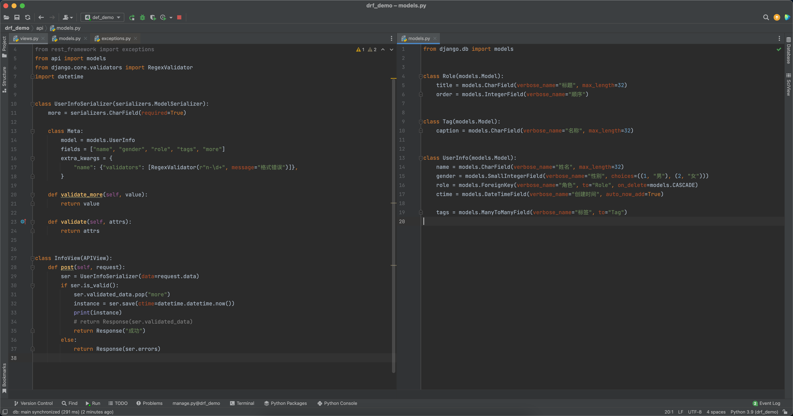

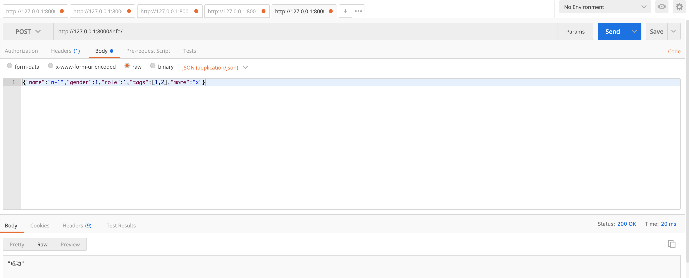


```python
# models.py
from django.db import models

class Role(models.Model):
    title = models.CharField(verbose_name="Title", max_length=32)
    order = models.IntegerField(verbose_name="Order")


class Tag(models.Model):
    caption = models.CharField(verbose_name="Name", max_length=32)


class UserInfo(models.Model):
    name = models.CharField(verbose_name="Name", max_length=32)
    gender = models.SmallIntegerField(verbose_name="Gender", choices=((1, "Male"), (2, "Female")))
    role = models.ForeignKey(verbose_name="Role", to="Role", on_delete=models.CASCADE)
    ctime = models.DateTimeField(verbose_name="Creation time", auto_now_add=True)

    tags = models.ManyToManyField(verbose_name="Tag", to="Tag")
```

```python
# views.py
from rest_framework.views import APIView
from rest_framework.response import Response
from rest_framework import serializers
from rest_framework import exceptions
from api import models
from django.core.validators import RegexValidator
import datetime


class UserInfoSerializer(serializers.ModelSerializer):
    more = serializers.CharField(required=True)

    class Meta:
        model = models.UserInfo
        fields = ["name", "gender", "role", "tags", "more"]
        extra_kwargs = {
            "name": {"validators": [RegexValidator(r"n-\d+", message="Format error")]},
        }

    def validate_more(self, value):
        return value

    def validate(self, attrs):
        return attrs


class InfoView(APIView):
    def post(self, request):
        ser = UserInfoSerializer(data=request.data)
        if ser.is_valid():
            ser.validated_data.pop("more")
            ser.save(ctime=datetime.datetime.now())
            # return Response(ser.validated_data)
            return Response("Success")
        else:
            return Response(ser.errors)
```


#### 2.2.7 The create Hook

When `save` is executed, the `create` or `update` method is called internally. If you want to customize the saving rules, you can also handle it here.

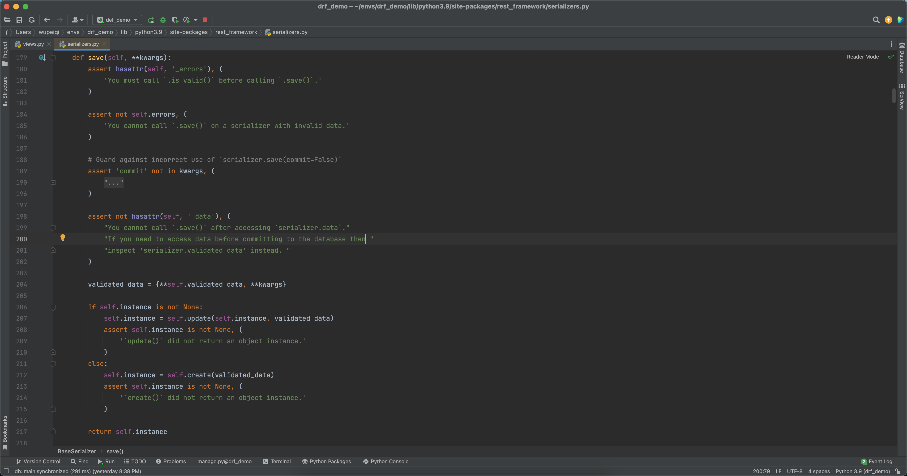


#### 2.3 Validation + Serialization

What if a request needs both request validation and serialization? For example, when adding data.

- Fields can be configured via `read_only`, `write_only`, and `required`.
- `read_only` is used only during serialization.
- `write_only` is used only during validation.
- `is_valid` for validation.
- `data` for serialization.

The `write_only` option is used to specify that a field can only be used for deserialization (input) and cannot be serialized (output). This means the field's value can only be provided when creating or updating an object, and it will not be included in the serialized data returned. It is usually used for sensitive information or fields that only need to be provided during creation or update, such as a password field.

Conversely, the `read_only` option is used to specify that a field can only be serialized (output) and cannot be deserialized (input). This means the field's value can only be obtained from the model and included in the serialized data returned, but it does not need to be provided when creating or updating an object.

##### 2.3.1 Combined into One

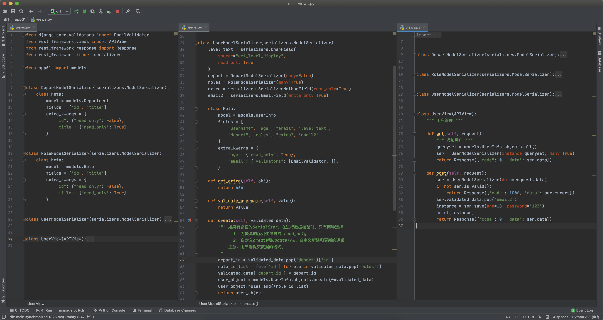

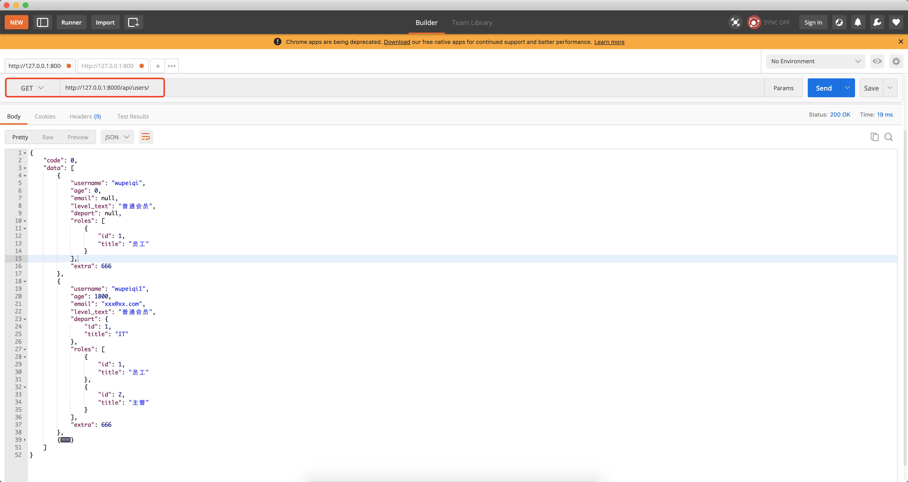

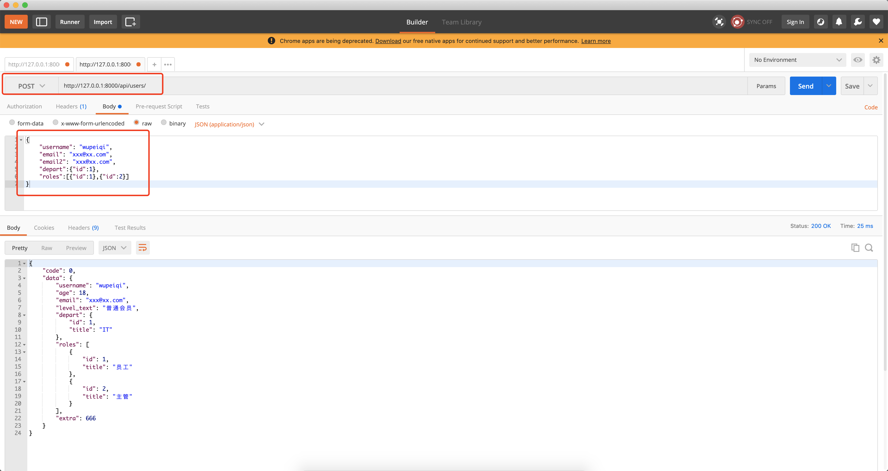


```python
# models.py

from django.db import models


class Role(models.Model):
    """ Role table """
    title = models.CharField(verbose_name="Name", max_length=32)


class Department(models.Model):
    """ Department table """
    title = models.CharField(verbose_name="Name", max_length=32)


class UserInfo(models.Model):
    """ User table """
    level_choices = ((1, "Regular member"), (2, "VIP"), (3, "SVIP"),)
    level = models.IntegerField(verbose_name="Level", choices=level_choices, default=1)

    username = models.CharField(verbose_name="Username", max_length=32)
    password = models.CharField(verbose_name="Password", max_length=64)
    age = models.IntegerField(verbose_name="Age", default=0)
    email = models.CharField(verbose_name="Email", max_length=64, null=True, blank=True)
    token = models.CharField(verbose_name="TOKEN", max_length=64, null=True, blank=True)

    depart = models.ForeignKey(verbose_name="Department", to="Department", on_delete=models.CASCADE, null=True, 		blank=True)
    roles = models.ManyToManyField(verbose_name="Role", to="Role")

```

```python
# urls.py

from django.urls import path, re_path, include
from app01 import views

urlpatterns = [
    path('api/users/', views.UserView.as_view()),
]

```

```python
# views.py

from django.core.validators import EmailValidator
from rest_framework.views import APIView
from rest_framework.response import Response
from rest_framework import serializers

from app01 import models


class DepartModelSerializer(serializers.ModelSerializer):
    class Meta:
        model = models.Department
        fields = ['id', "title"]
        extra_kwargs = {
            "id": {"read_only": False},  # Data validation
            "title": {"read_only": True}  # Serialization
        }


class RoleModelSerializer(serializers.ModelSerializer):
    class Meta:
        model = models.Role
        fields = ['id', "title"]
        extra_kwargs = {
            "id": {"read_only": False},  # Data validation
            "title": {"read_only": True}  # Serialization
        }


class UserModelSerializer(serializers.ModelSerializer):
    level_text = serializers.CharField(source="get_level_display", read_only=True)

    # Serializer nesting, not read_only, must customize create and update, custom logic for create and update.
    depart = DepartModelSerializer(many=False)
    roles = RoleModelSerializer(many=True)

    extra = serializers.SerializerMethodField(read_only=True)
    email2 = serializers.EmailField(write_only=True)

    # Data validation: username, email, email2, department, role info
    class Meta:
        model = models.UserInfo
        fields = [
            "username", "age", "email", "level_text", "depart", "roles", "extra", "email2"
        ]
        extra_kwargs = {
            "age": {"read_only": True},
            "email": {"validators": [EmailValidator, ]},
        }

    def get_extra(self, obj):
        return 666

    def validate_username(self, value):
        return value

    # When creating new data
    def create(self, validated_data):
        """ If there are nested Serializers, during data validation there are only two choices:
              1. Set the nested serializer to read_only
              2. Customize create and update methods, custom logic for creation and update
            Note: The format of data submitted by the client.
        """
        depart_id = validated_data.pop('depart')['id']

        role_id_list = [ele['id'] for ele in validated_data.pop('roles')]

        # Create user table
        validated_data['depart_id'] = depart_id
        user_object = models.UserInfo.objects.create(**validated_data)

        # Add corresponding relationships in the association table between users and roles
        user_object.roles.add(*role_id_list)

        return user_object


class UserView(APIView):
    """ User management """

    def get(self, request):
        """ Add user """
        queryset = models.UserInfo.objects.all()
        ser = UserModelSerializer(instance=queryset, many=True)
        return Response({"code": 0, 'data': ser.data})

    def post(self, request):
        """ Add user """
        ser = UserModelSerializer(data=request.data)
        if not ser.is_valid():
            return Response({'code': 1006, 'data': ser.errors})

        ser.validated_data.pop('email2')

        instance = ser.save(age=18, password="123", depart_id=1)

        # An object after creation (internally calls UserModelSerializer for serialization)
        print(instance)
        # ser = UserModelSerializer(instance=instance, many=False)
        # ser.data

        return Response({'code': 0, 'data': ser.data})

```


##### 2.3.2 Separate and Independent

When performing different functions, use different serializers to handle the business logic.

- GET request: return data (Serializer A).
- POST request: submit data (Serializer A) + return data (Serializer B).


**Underlying source code implementation:**

The underlying source code implementation of serialization differs from the other components described above. The definition and execution of serializer-related classes are invoked within the views, so the source code analysis process can be divided into: defining the class, serialization, and data validation.

Source 1: The serialization process

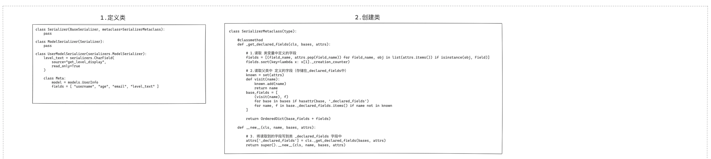

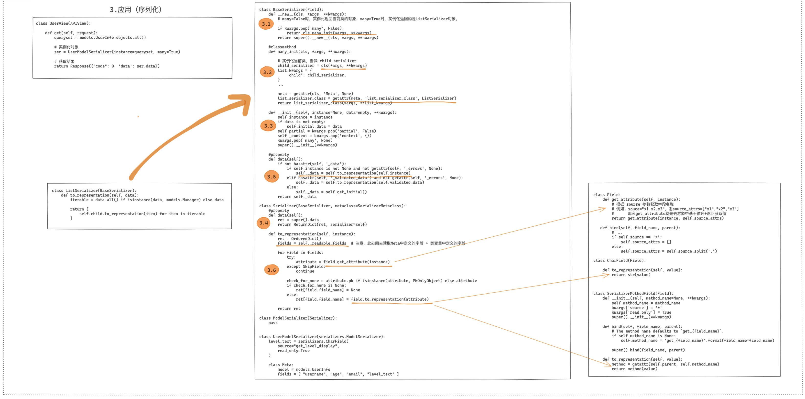

Source 2: The data validation process

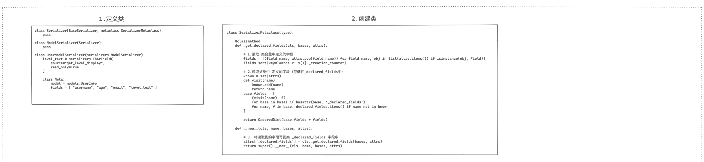

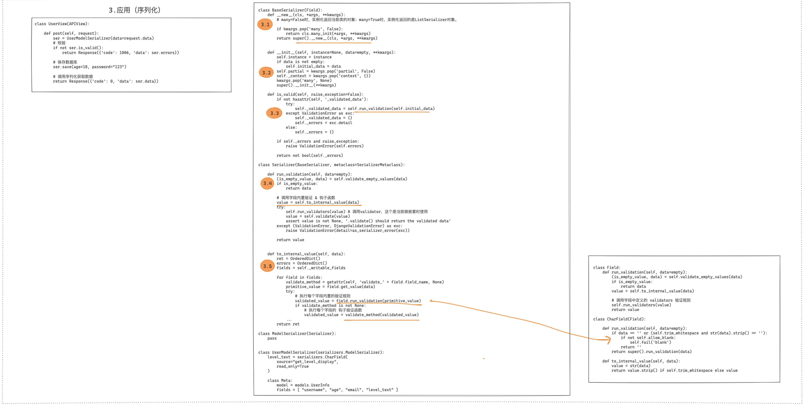


## 3 Pagination

In an API that returns a data list, if the amount of data is large, you certainly cannot show all of it to the user; instead, it needs to be displayed in pages.

DRF provides us with some pagination-related classes:

```
BasePagination, base class
PageNumberPagination(BasePagination)	Supports /accounts/?page=4&page_size=100 style pagination
LimitOffsetPagination(BasePagination)	Supports ?offset=100&limit=10 style pagination
```


### 3.1 PageNumberPagination

```
http://api.example.org/accounts/?page=4
http://api.example.org/accounts/?page=4&page_size=100
```

`page` indicates which page number, and `page_size` indicates how much data is displayed per page.

Two usage methods:

- To fix how many records per page, directly use `PageNumberPagination` along with the configuration file.

  When fixed, the pagination component directly reads the default value from the configuration file; no matter what parameter name and value are passed in the URL, the pagination result will not change.

  ```python
  # settings.py
  REST_FRAMEWORK = {
      "PAGE_SIZE": 10
  }
  ```

  ```python
  from app01 import models
  
  from rest_framework.views import APIView
  from rest_framework.request import Request
  from rest_framework.response import Response
  from rest_framework import serializers
  from rest_framework.pagination import PageNumberPagination, LimitOffsetPagination
  
  
  class UserSerializer(serializers.ModelSerializer):
      class Meta:
          model = models.UserInfo
          fields = "__all__"
  
  
  class UserView(APIView):
      def get(self, request: Request):
          queryset = models.UserInfo.objects.all()
          pagination = PageNumberPagination()
          queryset = pagination.paginate_queryset(queryset, request, self)
          ser = UserSerializer(instance=queryset, many=True)
          return Response({"status": True, "data": ser.data})
  ```

  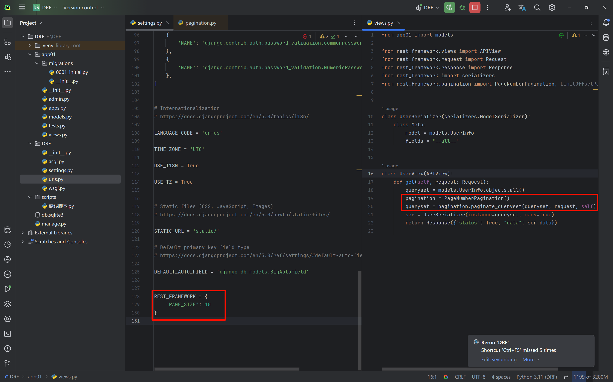

  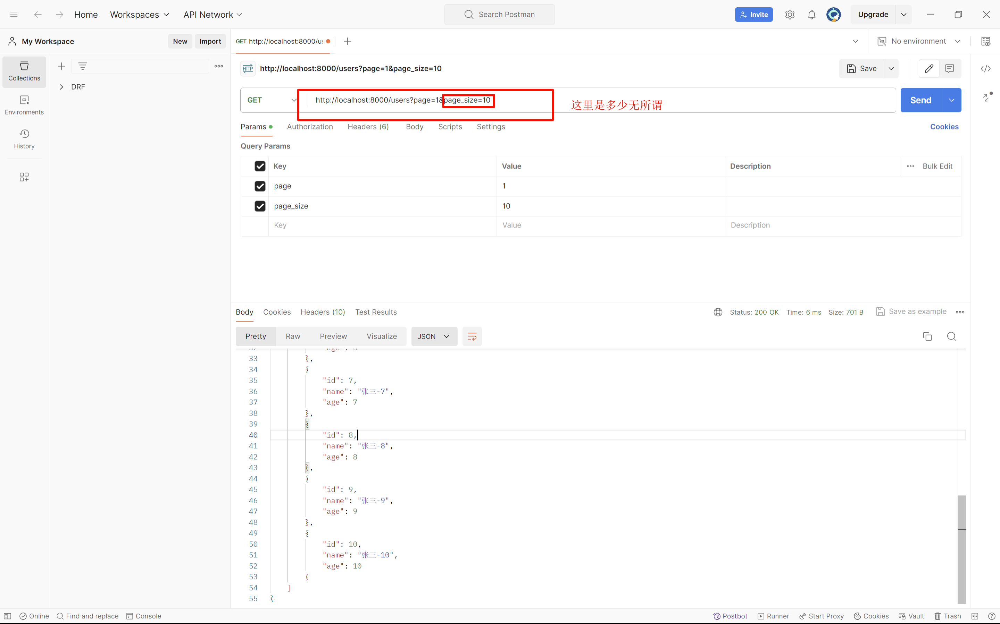

- To dynamically customize how many records are displayed per page based on the URL, you need to use class inheritance.

  When customizing, if no parameter is passed, the default configuration file is still read.

  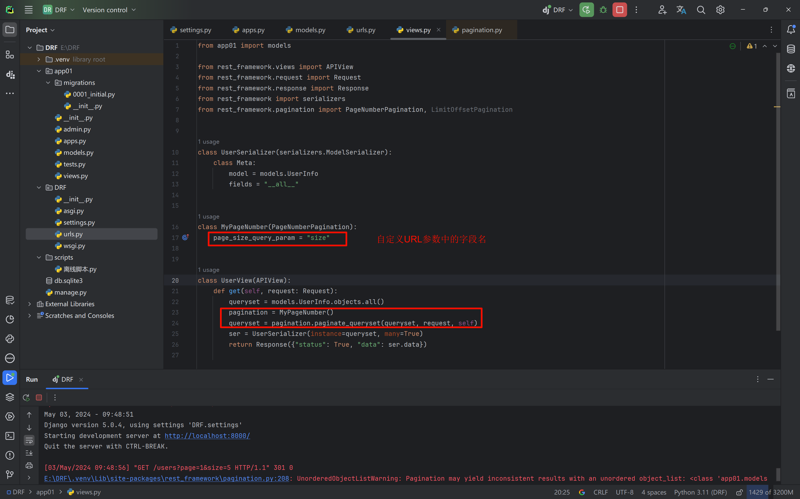

  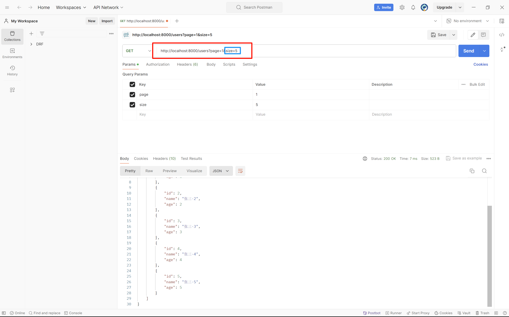

  ```python
  # views.py
  from app01 import models
  
  from rest_framework.views import APIView
  from rest_framework.request import Request
  from rest_framework.response import Response
  from rest_framework import serializers
  from rest_framework.pagination import PageNumberPagination, LimitOffsetPagination
  
  
  class UserSerializer(serializers.ModelSerializer):
      class Meta:
          model = models.UserInfo
          fields = "__all__"
  
  
  class MyPageNumber(PageNumberPagination):
      page_size_query_param = "size"
  
  
  class UserView(APIView):
      def get(self, request: Request):
          queryset = models.UserInfo.objects.all()
          pagination = MyPageNumber()
          queryset = pagination.paginate_queryset(queryset, request, self)
          ser = UserSerializer(instance=queryset, many=True)
          return Response({"status": True, "data": ser.data})
  ```


### 3.2 LimitOffsetPagination

`LimitOffsetPagination` is commonly used in technologies such as sliding pagination.

```
http://api.example.org/accounts/?limit=100
http://api.example.org/accounts/?offset=400&limit=100
```

`limit` indicates how much data is displayed on the current page, and `offset` indicates from which record onward the data should be displayed.

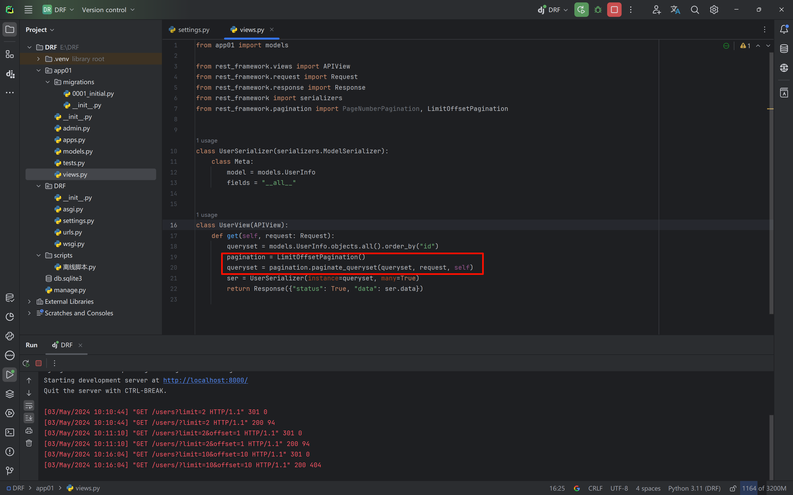

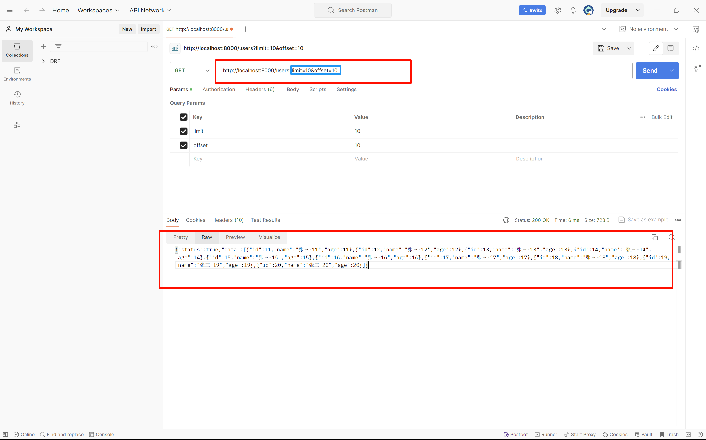

```python
# views.py
from app01 import models

from rest_framework.views import APIView
from rest_framework.request import Request
from rest_framework.response import Response
from rest_framework import serializers
from rest_framework.pagination import PageNumberPagination, LimitOffsetPagination


class UserSerializer(serializers.ModelSerializer):
    class Meta:
        model = models.UserInfo
        fields = "__all__"


class UserView(APIView):
    def get(self, request: Request):
        queryset = models.UserInfo.objects.all().order_by("id")
        pagination = LimitOffsetPagination()
        queryset = pagination.paginate_queryset(queryset, request, self)
        ser = UserSerializer(instance=queryset, many=True)
        return Response({"status": True, "data": ser.data})
```
