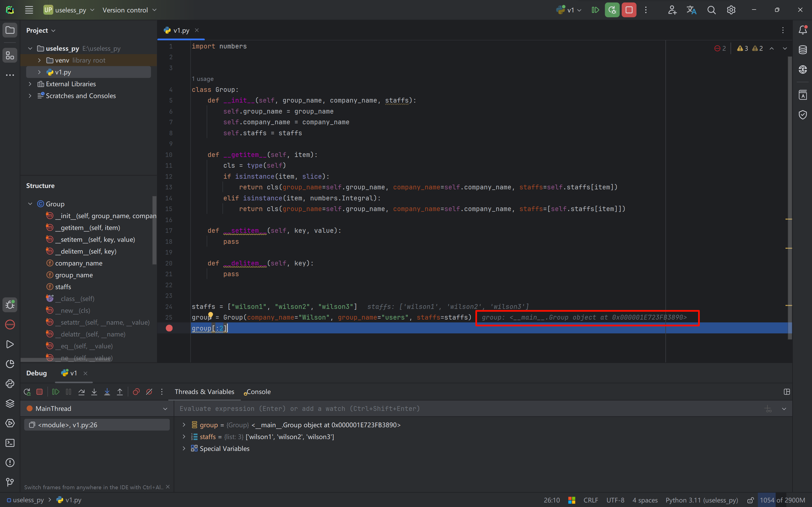
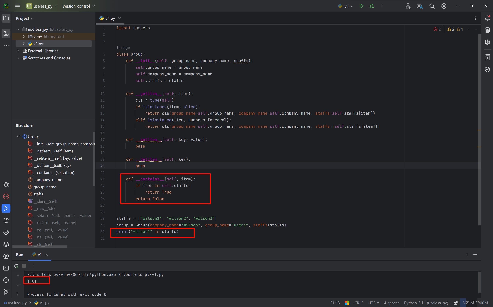
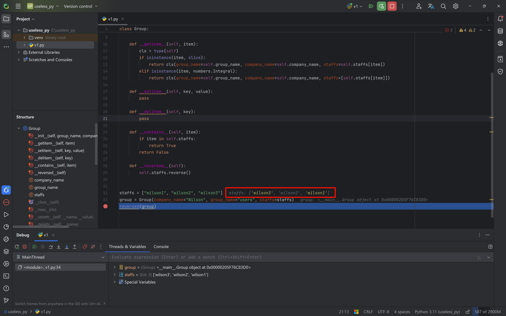
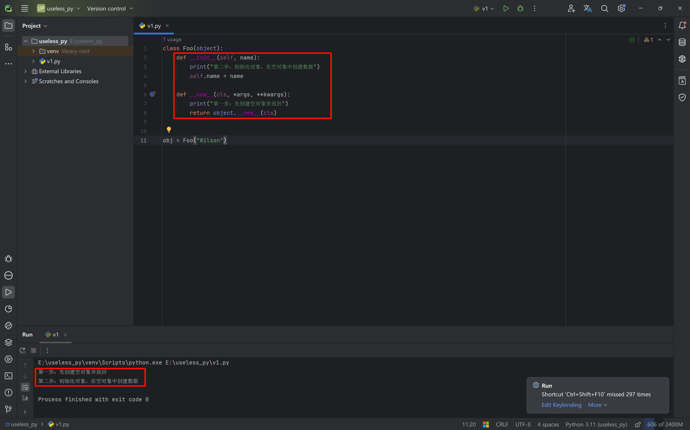
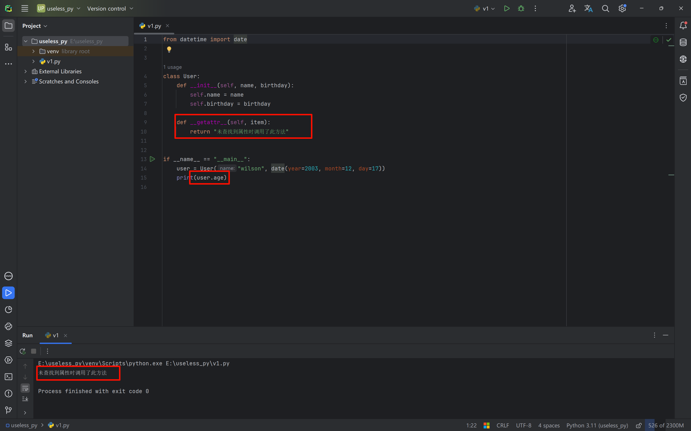
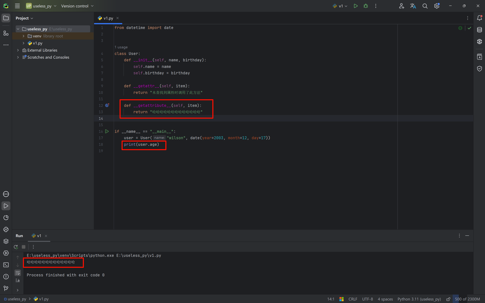
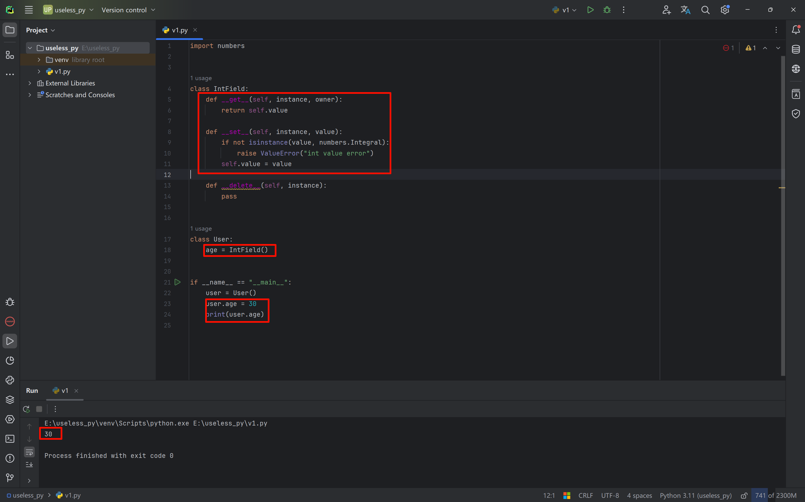

# Magic Functions

In Python classes, there are some special methods, all in the `__method__` format. These methods have special meanings internally. Next, let's talk about some common special members:

# String Representation

- `__repr__`: controls what this function returns for its instances.

  `__str__`: defines the string representation of an object.

  Difference: `__str__` is user-facing, while `__repr__` is developer-facing.

  Essentially, there isn't much difference between the two; as developers, we commonly use the `__str__` method.

  - Defining only `__str__`

  ```python
  class Foo():
      def __init__(self, name):
          self.name = name
  
      def __str__(self):
          return "hahaha"
  
      # def __repr__(self):
      #     return self.name + "custom content"
  
  foo = Foo("wilson")
  print(foo)				# hahaha
  print(foo.__str__())    # hahaha
  ```

  - Defining only `__repr__`

  ```python
  class Foo():
      def __init__(self, name):
          self.name = name
  
      # def __str__(self):
      #     return "hahaha"
  
      def __repr__(self):
          return self.name + "custom content"
  
  foo = Foo("wilson")
  print(foo)				# wilsoncustom content
  print(foo.__repr__())   # wilsoncustom content
  ```

  - Defining both

  ```python
  class Foo():
      def __init__(self, name):
          self.name = name
  
      def __str__(self):
          return "hahaha"
  
      def __repr__(self):
          return self.name + "custom content"
  
  foo = Foo("wilson")
  print(foo)				# hahaha
  print(foo.__str__())    # hahaha
  print(foo.__repr__())   # wilsoncustom content
  ```
  
  


# Collections and Sequences

- `__len()__`: returns the specified length.

  We can override this method in a class; when `len(class_instance)` is called, this method will be executed, and we can customize it to return the length of one or more members of the class.

- ```python
  class Foo(object):
      def __init__(self, name_list):
          self.name_list = name_list
          
      def __len__(self):
          return len(self.name_list)
      
  foo = Foo(["wilson", "tom"])    
  print(len(foo))		# 2
  ```
  
- `__getitem__`: converts variables passed into the class into an **iterable type**, making it easy to index or loop.

  `__setitem__`

  `__delitem__`

  ```python
  class Foo(object):
  
      def __getitem__(self, item):
          pass
  
      def __setitem__(self, key, value):
          pass
  
      def __delitem__(self, key):
          pass
  
  
  obj = Foo("Wilson", 19)
  
  obj["x1"]
  obj['x2'] = 123
  del obj['x3']
  ```

  We can implement slicing on objects through the above methods, for example:

  ```python
  import numbers
  
  
  class Group:
      def __init__(self, group_name, company_name, staffs):
          self.group_name = group_name
          self.company_name = company_name
          self.staffs = staffs
  
      def __getitem__(self, item):
          cls = type(self)
          if isinstance(item, slice):
              return cls(group_name=self.group_name, company_name=self.company_name, staffs=self.staffs[item])
          elif isinstance(item, numbers.Integral):
              return cls(group_name=self.group_name, company_name=self.company_name, staffs=[self.staffs[item]])
  
      def __setitem__(self, key, value):
          pass
  
      def __delitem__(self, key):
          pass
  
  
  staffs = ["wilson1", "wilson2", "wilson3"]
  group = Group(company_name="Wilson", group_name="users", staffs=staffs)
  group[:2]
  ```

  In the above code, after we implement the `__getitem__` method, slicing a `Group` object still yields a `Group` object.

  

- `__contains__`: used to determine whether a whole contains a part.

  In Python, to determine whether `x` is in the list `list`, we can use `if x in list`.

  Internally, this actually calls the `__contains__` method.

  We can also define a custom `__contains__` method in a class.

  

- `__reversed__`: by overriding this method, we can customize the ordering operation on elements.

  If we call the `reversed()` function, Python internally executes the `__reverse__` method.

  

### Callable

- `__call__`

  ```python
  class Foo(object):
      def __call__(self, *args, **kwargs):
          print("call method executed")
  
  
  obj = Foo()
  obj()
  ```

### Context Managers

- `__enter__`, `__exit__`

  ```python
  class Foo(object):
  
      def __enter__(self):
          print("entered")
          return 666
  
      def __exit__(self, exc_type, exc_val, exc_tb):
          print("exited")
  
  
  obj = Foo()
  with obj as data:
      print(data)
  ```
  
  Regarding context managers, the Python built-in `contextlib` module can also be used to implement them:

  ```python
  import contextlib
  
  
  @contextlib.contextmanager
  def file_open(file_name):
      print("entered")
      yield {}
      print("exited")
  
  
  with file_open("a.txt") as f:
      print("file")
  
  >>>entered
  >>>file
  >>>exited
  ```
  
  


### Numeric Conversion

- `__abs__`: returns the absolute value of a number.

  ```python
  class Foo():
      def __init__(self, num):
          self.num = num
  
      def __abs__(self):
          return abs(self.num)
  
  
  foo = Foo(-1)
  print(abs(foo))	# 1
  ```

- `__bool__`

- `__int__`

- `__float__`

- `__hash__`

- `__index__`

### Metaclass-Related

- `__new__`: the first argument passed is the class; it is called the constructor method and executes before the `__init__` method.

  ```python
  class Foo(object):
      def __init__(self, name):
          print("Step 2: Initialize object, create data in empty object")
          self.name = name
  
      def __new__(cls, *args, **kwargs):
          print("Step 1: Create empty object first and return it")
          return object.__new__(cls)
  
  
  obj = Foo("Wilson")
  ```

  Note: `kwargs` receives dictionary arguments, while `args` receives tuple arguments.

- `__init__`: the first argument passed is `self`; it is called the initialization method.

  ```python
  class Foo(object):
      def __init__(self, name):
          self.name = name
  
  
  obj = Foo("Wilson")
  ```




### Attribute-Related

- `__getattr__`: when Python calls a variable or attribute that does not exist, the `__getattr__` method in the class is called.

  `__setattr__`

  

- `__getattribute__`: when this method is defined, it is called whenever any attribute or variable of the class is accessed, whether or not it is defined, and the return value of this method is returned.

  `__setattribute__`

  

- `__dir__`

### Attribute Descriptors

- `__get__`, `__set__`, `__delete__`

  Implementing any one of these three methods in a class turns the class into an attribute descriptor.

  When we set a value on the class, the `__set__` method is automatically called; when getting a value, the `__get__` method is automatically called; when deleting a value, the `__delete__` method is automatically called.

  We can use this feature to constrain the attributes of variables in a class; the principle is the same as the Model in Django.

  For example:

  
  
  When a class only defines the `__get__` method, the descriptor is called a **non-data descriptor**.
  
  When a class defines all three methods `__get__`, `__set__`, and `__delete__`, the descriptor is called a **data descriptor**.
  
  ### Supplement: The Attribute Lookup Process in Python
  
  ```python
  '''
  If user is an instance of some class, then user.age (and equivalently getattr(user, ‘age’))
  first calls __getattribute__. If the class defines the __getattr__ method,
  then __getattr__ will be called when __getattribute__ raises AttributeError,
  and the invocation of descriptors (__get__) happens inside __getattribute__.
  user = User(), then the lookup order for user.age is as follows:
  
  (1) If “age” appears in the __dict__ of User or its base classes, and age is a data descriptor, call its __get__ method; otherwise
  
  (2) If “age” appears in obj(user)’s __dict__, return obj.__dict__[‘age’] directly; otherwise
  
  (3) If “age” appears in the __dict__ of User or its base classes
  
  (3.1) If age is a non-data descriptor, call its __get__ method; otherwise
  
  (3.2) Return __dict__[‘age’]
  
  (4) If User has a __getattr__ method, call __getattr__; otherwise
  
  (5) Raise AttributeError
  '''
  ```

### Coroutines

- `__aeait__`, `__aiter__`, `__anext__`, `__aenter__`, `__aexit__`

### Iterators and Generators

An iterator is a way to access elements in a collection, generally used to traverse data.

Iterators are different from subscript-based access; iterators do not support slicing.

Generators provide a lazy way to access data.

`__iter__` and `__next__`

- Iterator

  ```python
  # Iterator type definition:
      1. When a class defines both __iter__ and __next__ methods.
      2. The __iter__ method must return the object itself, i.e.: self
      3. The __next__ method returns the next piece of data; if there is no more data, it must raise a StopIteration exception.
  	Official docs: https://docs.python.org/3/library/stdtypes.html#iterator-types
          
  # Create an iterator type:
  class IT(object): 
      def __init__(self):
          self.counter = 0
  
      def __iter__(self):
          return self 
  
      def __next__(self):
          self.counter += 1
          if self.counter == 3:
              raise StopIteration()
          return self.counter
  
  
  # Instantiate the class to create an iterator object:
      obj1 = IT()
      
      # v1 = obj1.__next__()
      # v2 = obj1.__next__()
      # v3 = obj1.__next__() # throws exception
      
      v1 = next(obj1) # obj1.__next__()
      print(v1)
  
      v2 = next(obj1)
      print(v2)
  
      v3 = next(obj1)
      print(v3)
  
  
      obj2 = IT()
      for item in obj2:  # First executes the iterator object's __iter__ method to get the return value, then repeatedly calls next(obj) 
          print(item)
          
  Iterator objects support getting values via next(); when values are exhausted, StopIteration is raised automatically.
  Inside a for loop, __iter__ is first called to obtain an iterator object, then next() is called repeatedly (the loop stops when StopIteration is raised).
  ```

- Generator

  ```python
  # Create a generator function
  def func():
      yield 1
      yield 2
  
  
  # Create a generator object (internally an object created from the generator class); the generator class also declares __iter__ and __next__ internally.
  # Generator objects are produced when Python compiles the bytecode
  obj1 = func()
  
  v1 = next(obj1)
  print(v1)
  
  v2 = next(obj1)
  print(v2)
  
  v3 = next(obj1)
  print(v3)
  
  obj2 = func()
  for item in obj2:
      print(item)
      
  
  # By the iterator definition, the generator class is actually a special kind of iterator class (a generator is a special iterator).
  ```

- Iterable Object

  If a class has an `__iter__` method that returns an iterator object, then objects created from this class are called iterable objects.

  ```python
  class Foo(object):
      
      def __iter__(self):
          return iterator_object(generator_object)
      
  obj = Foo() # obj is an iterable object.
  
  # Iterable objects can be looped over with for; internally the loop first calls __iter__ to get the iterator object, then repeatedly calls next() on it to fetch values.
  for item in obj:
      pass
  ```

  ```python
  class IT(object):
      def __init__(self):
          self.counter = 0
  
      def __iter__(self):
          return self
  
      def __next__(self):
          self.counter += 1
          if self.counter == 3:
              raise StopIteration()
          return self.counter
  
  
  class Foo(object):
      def __iter__(self):
          return IT()
  
  
  obj = Foo() # iterable object
  
  
  for item in obj: # When looping an iterable object, obj.__iter__ is called first to get the iterator; then the iterator's next() is called repeatedly.
      print(item)
  ```

  ```python
  # Implement a custom range based on iterable objects & iterators
  class IterRange(object):
      def __init__(self, num):
          self.num = num
          self.counter = -1
  
      def __iter__(self):
          return self
  
      def __next__(self):
          self.counter += 1
          if self.counter == self.num:
              raise StopIteration()
          return self.counter
  
  
  class Xrange(object):
      def __init__(self, max_num):
          self.max_num = max_num
  
      def __iter__(self):
          return IterRange(self.max_num)
  
  
  obj = Xrange(100)
  
  for item in obj:
      print(item)
  ```

  

  ```python
  class Foo(object):
      def __iter__(self):
          yield 1
          yield 2
  
  
  obj = Foo()
  for item in obj:
      print(item)
  ```

  ```python
  # Implement a custom range based on iterable objects & generators
  
  class Xrange(object):
      def __init__(self, max_num):
          self.max_num = max_num
  
      def __iter__(self):
          counter = 0
          while counter < self.max_num:
              yield counter
              counter += 1
  
  
  obj = Xrange(100)
  for item in obj:
      print(item)
  ```

- Common data types:

  ```python
  v1 = list([11,22,33,44])
  
  v1 is an iterable object, because the list declares an __iter__ method that returns an iterator object.
  ```

  ```python
  from collections.abc import Iterator, Iterable
  
  v1 = [11, 22, 33]
  print( isinstance(v1, Iterator) )  # False; checks whether it is an iterator, based on __iter__ and __next__.
  v2 = v1.__iter__()
  print( isinstance(v2, Iterator) )  # True
  
  
  
  v1 = [11, 22, 33]
  print( isinstance(v1, Iterable) )  # True; the check is based on whether __iter__ exists and returns an iterator object.
  
  v2 = v1.__iter__()
  print( isinstance(v2, Iterable) )  # True; the check is based on whether __iter__ exists and returns an iterator object.
  ```

### Others

- `__dict__`: queries all attributes in a class or in an instance's variables.

  (You can also use the `dir()` function to get more detailed attribute information.)

  ```python
  class Foo(object):
      def __init__(self, name, age):
          self.name = name
          self.age = age
  
  
  obj = Foo("Wilson",19)
  print(obj.__dict__)
  ```

- `__add__` and so on.

  ```python
  class Foo(object):
      def __init__(self, name):
          self.name = name
  
      def __add__(self, other):
          return "{}-{}".format(self.name, other.name)
  
  
  foo1 = Foo("wilson")
  foo2 = Foo("123")
  
  # object + value: internally calls object.__add__, passing the value after the + as the "other" argument.
  v3 = foo1 + foo2
  print(v3)	# wilson-123
  ```
